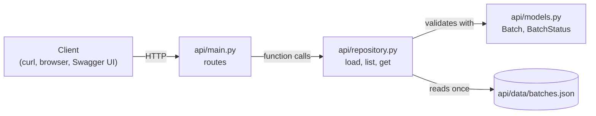
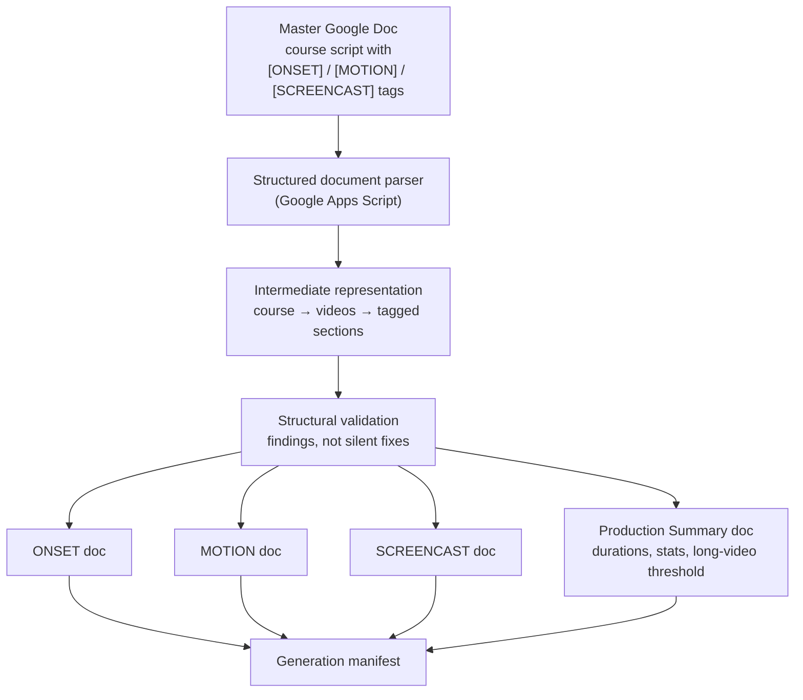

# Architecture

This document has two parts: the **implemented** API (Phase 1) and the **planned** document automation workflow (Phases 3 and 4). Only the first part exists in code.

## Part 1: Implemented API

The API is three small modules plus a data file.

| Module | Responsibility | Depends on |
|---|---|---|
| `models.py` | Pydantic models (`Batch`, `HealthResponse`, `ErrorResponse`) and the `BatchStatus` enum | Pydantic |
| `repository.py` | Reads the JSON file, validates every record, rejects duplicate IDs, sorts by `batch_id`, and provides `list_batches` and `get_batch` | `models.py` |
| `main.py` | Defines the FastAPI app, routes, response models, and the 404 error | `models.py`, `repository.py` |

### Design notes

- **HTTP is separate from data access.** `repository.py` doesn't import FastAPI. Its functions return models or `None`, and `main.py` decides on status codes. That's why `tests/test_repository.py` can test the data layer without HTTP.
- **Paths don't depend on the working directory.** The data file is found with `Path(__file__).parent / "data" / "batches.json"`.
- **Validation happens at load time.** `Batch` uses `extra="forbid"`, `status` must be a `BatchStatus`, and `days_since_start` must be ≥ 0. A bad record raises an error instead of being skipped.
- **The data is loaded once.** The bundled dataset is cached with `functools.cache` as an immutable tuple. Because the file never changes while the app runs, the cache can't go stale. The file is re-read on restart.
- **The output is deterministic.** Results are sorted by `batch_id`, and nothing depends on time, randomness, or the network.
- **Status filtering uses an enum.** FastAPI validates `?status=` against `BatchStatus`, so it returns 422 for unsupported values automatically, and the allowed values appear in the OpenAPI schema.

## Part 2: Planned document automation workflow (not implemented)

The learning lab's real goal is to turn a master course script into several production documents. The planned pipeline:

1. **Master Google Doc**: one authored script per course, organized by video, with each section tagged.
2. **Parser**: reads the document structure (headings, tags, body text).
3. **Intermediate representation**: a plain data structure that separates parsing from output, so each generator works on clean data.
4. **Structural validation**: reports problems such as unknown or missing tags, empty sections, or unexpected ordering.
5. **Generators**: produce the three section-specific documents and a Production Summary with approximate video durations and a configurable long-video warning.
6. **Generation manifest**: records what was generated, from which source, and any validation findings.

These details are intent, not a specification, and may change during Phases 3 and 4.
