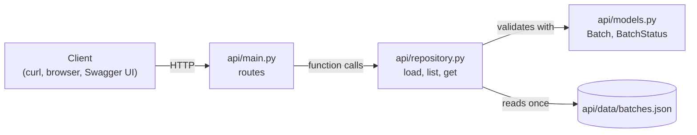
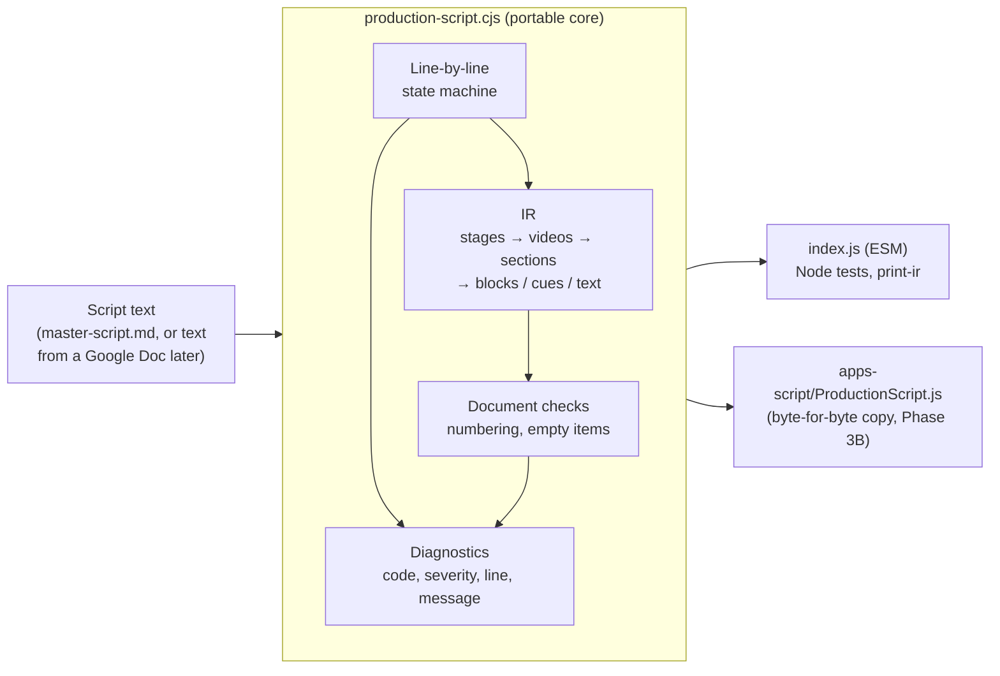
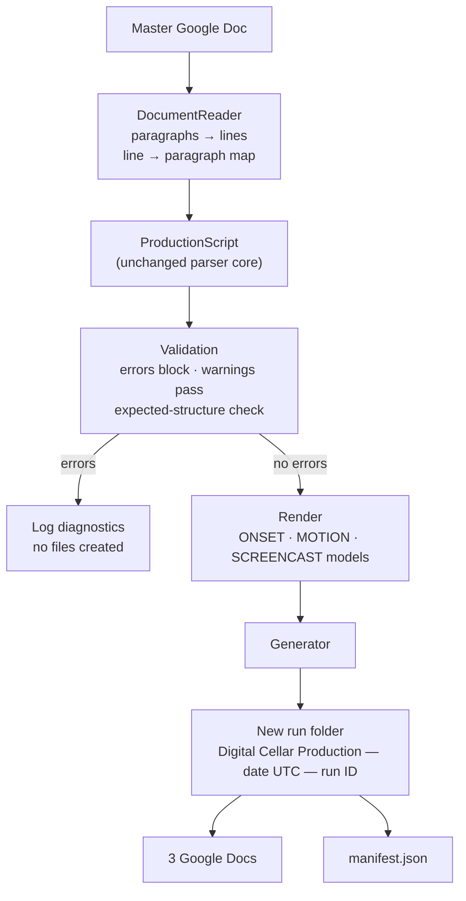
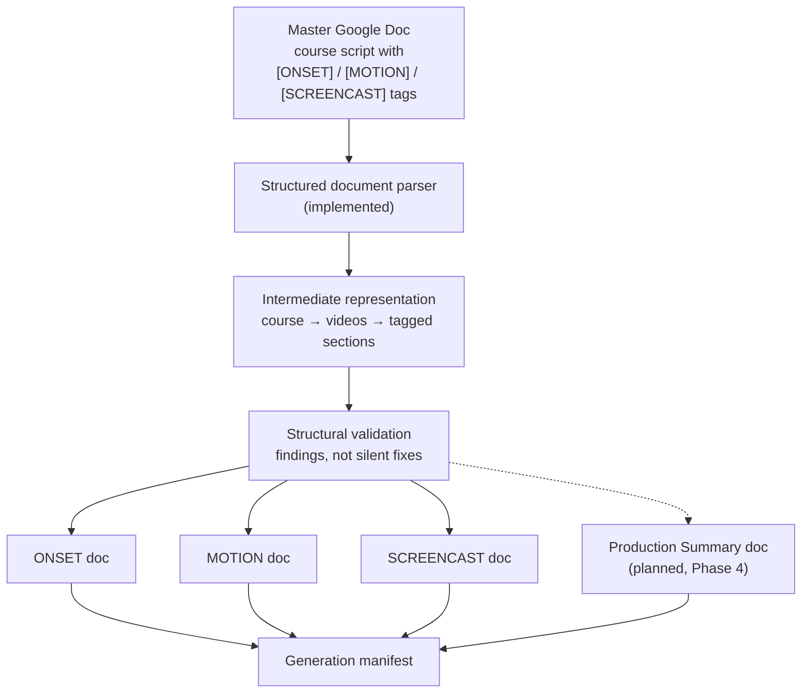

# Architecture

This document has four parts:

1. The **implemented** API (Phase 1).
2. The **written** master script and its fixtures (Phase 2).
3. The **implemented** portable parser and validator (Phase 3A).
4. The **implemented** Google Docs integration and ONSET/MOTION/SCREENCAST generation (Phase 3B), and the **planned** Production Summary (Phase 4).

All implemented code is tested offline. The Google Docs integration hasn't yet been run against a real Google account. That's a manual checkpoint, described in [`apps-script/README.md`](../apps-script/README.md#live-verification-checklist).

## Part 1: Implemented API

The API is three small modules plus a data file.

| Module | Responsibility | Depends on |
|---|---|---|
| `models.py` | Pydantic models (`Batch`, `HealthResponse`, `ErrorResponse`) and the `BatchStatus` enum | Pydantic |
| `repository.py` | Reads the JSON file, validates every record, rejects duplicate IDs, sorts by `batch_id`, and provides `list_batches` and `get_batch` | `models.py` |
| `main.py` | Defines the FastAPI app, routes, response models, and the 404 error | `models.py`, `repository.py` |

### Design notes

- **HTTP is separate from data access.** `repository.py` doesn't import FastAPI. Its functions return models or `None`, and `main.py` decides on status codes. That's why `tests/test_repository.py` can test the data layer without HTTP.
- **Paths don't depend on the working directory.** The data file is found with `Path(__file__).parent / "data" / "batches.json"`.
- **Validation happens at load time.** `Batch` uses `extra="forbid"`, `status` must be a `BatchStatus`, and `days_since_start` must be ≥ 0. A bad record raises an error instead of being skipped.
- **The data is loaded once.** The bundled dataset is cached with `functools.cache` as an immutable tuple. Because the file never changes while the app runs, the cache can't go stale. The file is re-read on restart.
- **The output is deterministic.** Results are sorted by `batch_id`, and nothing depends on time, randomness, or the network.
- **Status filtering uses an enum.** FastAPI validates `?status=` against `BatchStatus`, so it returns 422 for unsupported values automatically, and the allowed values appear in the OpenAPI schema.

## Part 2: The master script (implemented as content)

[`course/master-script.md`](../course/master-script.md) is the **authoritative source** for every production document. It's plain text built around literal stage and video headings, `[ONSET]` / `[MOTION]` / `[SCREENCAST]` sections, and internal annotations. The full grammar is in [`course/README.md`](../course/README.md#script-grammar).

Two fixtures support the parser:

- [`course/fixtures/expected-structure.json`](../course/fixtures/expected-structure.json): the expected stages, videos, and section order, written independently of the script.
- [`course/fixtures/malformed-script.md`](../course/fixtures/malformed-script.md): isolated invalid cases, with their expected failures documented in [`course/fixtures/README.md`](../course/fixtures/README.md).

The parser in Part 3 reads the script and fixtures in its tests.

## Part 3: Implemented parser and validation (Phase 3A)

[`parser/`](../parser) contains a dependency-free JavaScript parser. It turns script text into an intermediate representation (IR) and a list of diagnostics. The details are in [`parser/README.md`](../parser/README.md).

| Component | Responsibility | Runs in |
|---|---|---|
| `src/production-script.cjs` | Parsing, IR construction, structural and document checks, diagnostics | Any JavaScript engine: no modules or host APIs |
| `src/index.js` | Re-exports the core as an ES module | Node.js |
| `src/print-ir.js` | Prints the parse result for a file as JSON | Node.js |
| `tests/` | Acceptance tests against the course fixtures, plus edge-case, diagnostic, and portability tests | Node.js `node:test` |

### Design notes

- **The IR says what each piece of content is.** Section order is kept exactly as written, including repeated types. Annotations become typed blocks, and `[PAUSE]` becomes a cue. Text lines are kept verbatim with their source line numbers. Generators won't need to reread the source.
- **What's spoken is marked by structure.** ONSET text and `VOICEOVER` blocks are spoken. The parser never judges content by its wording.
- **Diagnostics are returned, not thrown.** Malformed input produces a partial document and stable diagnostic codes, sorted by line. Only a non-string argument throws.
- **Recovery is conservative.** Nothing is closed, created, or repaired without a diagnostic. Document checks run only when there are no structural errors, which keeps follow-on noise down.
- **The parser checks grammar, not the course's shape.** The two-stages-of-three-videos shape is checked by the acceptance test against `course/fixtures/expected-structure.json`.
- **The core is portable.** It's one classic script with a single global and a CommonJS guard for Node. Tests run it in an empty `vm` context, but it hasn't yet been run in Google Apps Script.

## Part 4: Google Docs workflow

### Implemented (Phase 3B)

[`apps-script/`](../apps-script) is a Google Apps Script project with two manual entry points: `validateMasterDocument()` (read-only) and `generateProductionDocuments()`. Setup and operation are documented in [`apps-script/README.md`](../apps-script/README.md).

| File | Responsibility | Tested offline |
|---|---|---|
| `ProductionScript.js` | Byte-for-byte copy of the parser core | Yes. A drift check runs in CI. |
| `GeneratedData.js` | Expected structure, parser version, and core hash, generated from the repository | Yes. A drift check runs in CI. |
| `Config.js` | Script Properties: master document ID, optional output folder, structure-check switch | Yes |
| `DocumentReader.js` | Body → text lines, soft line breaks, and unsupported-content diagnostics | Yes, with Body test doubles |
| `Validation.js` | Parse, map diagnostics to paragraphs, compare structure, decide generate/block, format the log | Yes |
| `Render.js` | Role selection and paragraph models, verbatim and in source order | Yes |
| `Manifest.js` | Run folder naming and the manifest object | Yes |
| `Generator.js` | Run orchestration through injected services, including partial-failure handling | Yes, with fake services |
| `GoogleServices.js` | `DocumentApp`, `DriveApp`, and `Utilities` calls | No. Covered only by the live checkpoint. |
| `Main.js` | Entry points and logging | No. Covered only by the live checkpoint. |

### Design notes

- **The parser is the only interpreter.** The adapter only turns paragraphs into text, and it never infers structure from formatting. All structure comes from the unchanged parser core.
- **The parser exists once.** `parser/src/production-script.cjs` is the source. `scripts/sync-apps-script.mjs` writes the Apps Script copy, and `--check` (run in CI) fails on any difference.
- **Logic is testable apart from Google.** Every Google API call is in `GoogleServices.js`. The other files load in Node exactly as Apps Script loads them: as plain scripts in one shared global scope.
- **The decision comes before the first write.** Configuration, document access, extraction, parsing, the structure check, and the output folder are all checked, and all three documents are rendered in memory, before anything is created in Drive. Error-level diagnostics stop the run with no files created. Warnings are allowed and recorded in the manifest.
- **The acceptance checkpoint.** By default (`REQUIRE_EXPECTED_STRUCTURE=true`), the Google Doc must reproduce `course/fixtures/expected-structure.json` exactly. The parser stays generic, and the check can be turned off for other courses.
- **Runs are independent.** Every run creates a new folder named with its UTC timestamp and run ID. Nothing from earlier runs is reused, overwritten, or deleted.
- **Provenance.** `manifest.json` records the source document ID, URL, title, and last-updated time, a SHA-256 hash of the extracted text, the parser version and core hash, each output's role, ID, and URL, counts, warnings, and status. It contains no document content.
- **Partial failures.** A failed write throws. If the run folder exists, a `"failed"` manifest listing every created document is written to it, and the folder is renamed with ` — FAILED`. Nothing is deleted.

### Planned (Phase 4)

- **Production Summary:** a fourth document with estimated durations, content statistics, the configurable long-video threshold, and validation findings.

### Full pipeline

1. **Master Google Doc** *(read in Phase 3B)*: one authored script per course, organized by video, with each section tagged.
2. **Parser** *(core in Phase 3A, running in Apps Script in Phase 3B)*: reads the document structure (headings, tags, body text).
3. **Intermediate representation** *(implemented in Phase 3A)*: a plain data structure that separates parsing from output, so each generator works on clean data.
4. **Structural validation** *(implemented in Phase 3A)*: reports problems such as unknown or missing tags, empty sections, or unexpected ordering.
5. **Generators**: the three section-specific documents are implemented (Phase 3B). The Production Summary, with approximate video durations and a configurable long-video warning, is planned (Phase 4).
6. **Generation manifest** *(implemented in Phase 3B)*: records what was generated, from which source, and any validation warnings.

### Source of truth and regeneration

- **One direction only.** Changes go into the master Google Doc. Generated documents are derivative outputs and are never edited to change the course.
- **No synchronization.** Generated documents aren't kept in sync with the master. If the master changes after generation, the existing outputs stay as they were.
- **Regeneration creates a new set.** Running the generator again produces a new, identifiable set of documents with its own generation manifest. That's three documents now, and four once the Production Summary exists. It doesn't update the previous set in place, so you can always tell which version of the master a set came from.

The Production Summary is intent, not a specification, and may change during Phase 4.
