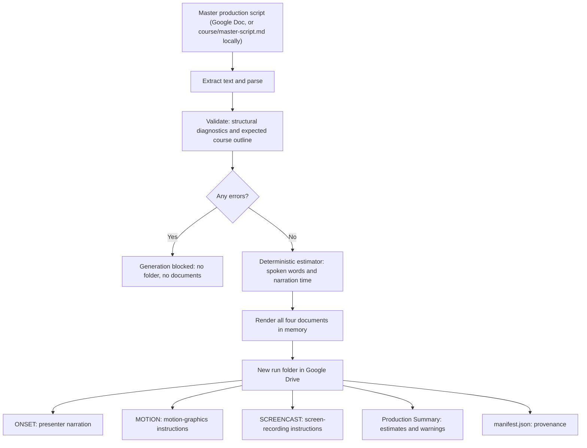

# One Script, Four Documents: A Document Automation Lab

A hands-on lab that teaches **deterministic document automation** using a small, complete, open-source system. One structured video-course script is parsed, validated, estimated, and turned into four role-specific Google Docs, with a manifest that records where every output came from.

- **Time:** about 60 minutes for the five core exercises, plus 45 to 60 minutes for the optional Google Docs exercise
- **Needs:** Git, Node.js 22+, a terminal, and a text editor. No accounts, keys, or paid services. A Google account is needed only for the optional exercise.
- **Start here:** [the learning lab](lab/README.md)

## What you'll learn

- Why hand-maintaining several versions of one script drifts out of sync, and how a single tagged source avoids it
- How a parser turns a human-readable script into a deterministic intermediate representation, and reports structural problems as coded diagnostics
- Why validation is a gate: invalid input generates nothing
- How a duration estimate separates counted facts from stated assumptions
- What a provenance manifest and its hashes do and don't prove, and why outputs are regenerated instead of edited

The [full list of twelve objectives](lab/README.md#learning-objectives) maps each one to an exercise.

## How it works

If the diagram doesn't appear, the block above is its source, and the [lab overview](lab/README.md#the-system-in-one-picture) has the same flow as text.

Everything up to the in-memory render is plain JavaScript that runs, and is tested, in Node.js. The core lab exercises it locally. Only the last step writes to Google Drive, through Google Apps Script. Invalid estimator settings also stop a run before anything is written. Each part is described in [the architecture notes](https://github.com/kenwalger/cellar-api/blob/main/docs/architecture.md).

## Exercises

| | Exercise | Time | Google account? |
|---|---|---|---|
| 0 | [Set up](lab/00-setup.md) | 5 min | No |
| 1 | [Inspect the source](lab/01-inspect-the-source.md) | 10 min | No |
| 2 | [Parse and validate](lab/02-parse-and-validate.md) | 10 min | No |
| 3 | [Break the contract](lab/03-break-the-contract.md) | 10 min | No |
| 4 | [Estimate production](lab/04-estimate-production.md) | 12 min | No |
| 5 | [Provenance and regeneration](lab/05-provenance-and-regeneration.md) | 10 min | No |
| 6 | [Optional: generate the Google Docs](lab/06-google-docs-extension.md) | 45 to 60 min | Yes |

Also see [troubleshooting](lab/troubleshooting.md), the [evidence guide](lab/evidence/README.md), and the [maintainer and instructor guide](lab/maintainers.md).

## The optional Google Docs exercise

Exercise 6 runs the real workflow. You paste the script into a Google Doc, add the Apps Script files to a project of your own, authorize two scopes (Docs and Drive), validate, and generate. You get a new Drive folder with the four documents and `manifest.json`. Generating again creates a second folder and leaves the first one untouched. The project owner has reported successful live runs of the role documents and the Production Summary. The newest formatting changes haven't been checked live yet, and the exercise tells you what to look for.

## The subject of the course

The scripts are for a fictional video course, *Understanding APIs: A Winery's Digital Cellar*. The small read-only winery API it teaches is in this repository, and you can [run it locally](https://github.com/kenwalger/cellar-api/blob/main/README.md#running-the-api) with Python and uv. The lab doesn't need it.

## Screenshots

No screenshots have been published yet. They'll be added here from real runs only, following the [evidence guide](lab/evidence/README.md).

## Source

The source code, the issue tracker, and the full documentation are in the GitHub repository [kenwalger/cellar-api](https://github.com/kenwalger/cellar-api). It's MIT licensed, © 2026 Ken W. Alger.
